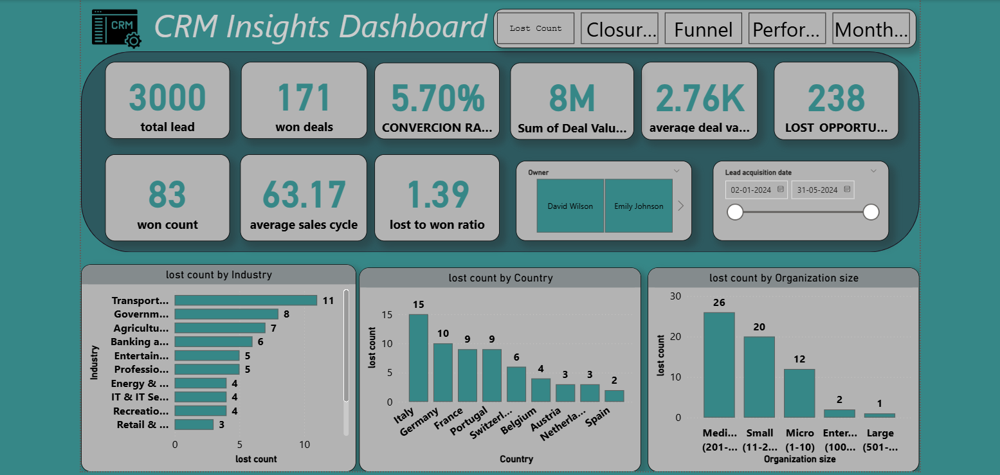

# Hi, I'm Muhammed Muhsin 👋

**Data Analyst | MCA Graduate | Power BI • SQL • Excel • Python**

I turn raw data into clear dashboards and insights that support better business decisions. I have hands-on internship experience in data analysis and AI/ML, and I'm currently looking for Data Analyst, Business Analyst and MIS roles in Kerala.

[LinkedIn](https://www.linkedin.com/in/muhammed-muhsin-m/) · [Email](mailto:muhsintm777@gmail.com) · [GitHub](https://github.com/muhsinm7)

---

## 🛠️ Skills

| Area | Tools |
|---|---|
| Data analysis | SQL, Excel (Power Query, VBA macros), Python, Statistical Analysis |
| Visualization & BI | Power BI, DAX, Tableau, Dashboard Reporting, KPI Tracking |
| Data work | Data Cleaning, Data Wrangling, Data Modeling, ETL |
| Other | Documentation, Stakeholder Reporting, HTML |

---

## 📊 Projects

### 1. CRM Sales Pulse Dashboard

An interactive Power BI dashboard that gives decision-makers a clear view of the sales pipeline.

- **What I built:** An interactive dashboard tracking 6 KPIs, including leads, conversions and agent performance.
- **Data preparation:** Cleaned and modeled the CRM data using Power Query and DAX, reducing report preparation time by 50%.
- **Impact:** Delivered segment-wise and regional sales insights, improving sales pipeline visibility for decision-makers.
- **Tools:** Power BI, Power Query, DAX

### 2. Automated Task Tracker

An Excel automation tool that reduces repetitive manual work.

- **What I built:** An Excel VBA automation tool with 5+ macros, reducing manual task time by 60%.
- **Impact:** Automated report generation and input validation, improving data accuracy and team efficiency by 35%.
- **Tools:** Excel VBA, Macros

---

## 💼 Experience

**Data Analyst Intern**, Rows and Column
*Oct 2025 – Mar 2026*
- Cleaned and standardized 10,000+ records per month, reducing data errors by ~30% and improving reporting accuracy.
- Built 3+ interactive Power BI dashboards and SQL-based reports, cutting manual reporting time by 40%.
- Monitored 5+ KPIs weekly using Excel and Power BI dashboards, enabling faster business decisions.
- Maintained data logs and documentation for 4+ ongoing projects, ensuring 100% audit-ready data quality.

**AI/ML Intern**, Axivise Technologies Pvt. Ltd.
*Mar 2025 – Jun 2025*
- Prepared and validated 5,000+ data entries for AI/ML model training pipelines, achieving a 98% accuracy rate.
- Performed quality checks on 20+ project outputs, reducing error rates and improving model reliability.
- Maintained structured documentation and tracking logs for 3+ concurrent AI research projects.

---

## 🎓 Education

**Master of Computer Applications (MCA)**
Chinmaya Institute of Technology, Kannur University (2023 – 2025)

---

## 📚 Currently Learning

- Advanced SQL: window functions, CTEs, query optimisation
- Building more end-to-end Power BI dashboards

---

## 📫 Get in touch

I'm open to Data Analyst, Business Analyst, MIS Executive and Power BI roles, as well as internships. Feel free to connect with me on [LinkedIn](https://www.linkedin.com/in/muhammed-muhsin-m/).

